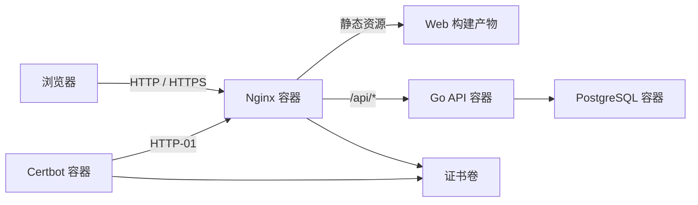

# Dezhonger Service

Dezhonger Service 是一套可独立部署的个人工具服务，包含浏览器端数学与代码工具、服务器延迟测试、带离线队列的私人备忘录、只读数据库浏览器、用户管理 API，以及完整的 Docker Compose 部署配置。

## 功能

- 精确数学工具
  - 数论：素数判定、质因数分解、精确素数计数、GCD、LCM、Bézout 等式、模逆元和广义中国剩余定理。
  - 方程：二次、三次和四次方程的精确或高精度求解。
  - 矩阵：行列式、秩、迹、转置、RREF、逆矩阵、零空间、列空间、特征空间、PLU、LDU、LDLT、QR 和 SVD。
- 代码工具
  - 多语言代码注释去除。
  - 基于 Monaco Editor 的文本差异对比。
- 私人备忘录
  - Markdown 编辑与安全预览。
  - 自动保存、本地缓存和断网操作队列。
  - 搜索、标签、分类、状态、置顶、导入和导出。
  - 每个用户的数据严格隔离。
- 账号管理
  - 管理员创建用户、设置角色、停用账号和重置临时密码。
  - 不开放公开注册。
  - 临时密码首次登录后必须修改。
- 服务器测速
  - 连续采样浏览器到服务器的 HTTPS 往返延迟。
  - 展示最低值、中位数、P95、抖动以及 DNS/TCP/TLS/TTFB 加载阶段。
- 数据库浏览器
  - 管理员只读查看 `public` schema 的表、字段结构和分页数据。
  - 自动隐藏密码、会话令牌、密钥等敏感列，不提供任意 SQL 或写入操作。

## 架构



数学和代码计算在浏览器内执行；服务器负责静态文件、认证、用户管理、备忘录数据、延迟探针和受控的数据库只读浏览。

## 本地验证

```bash
cd web
npm ci
npm test
npm run build

cd ../api
go test ./...
go build ./cmd/api

cd ..
docker compose config
docker compose build
```

## 部署

服务器只需要 Git 与 Docker。部署目录推荐为 `~/service`。

```bash
git clone https://github.com/dezhonger/dezhonger-service.git ~/service
cd ~/service
cp .env.example .env
```

在 `.env` 中设置公网 IP、主域名、HTTPS Origin 和随机数据库密码，然后启动：

```bash
docker compose up -d --build
docker compose ps
curl http://127.0.0.1/api/healthz
```

创建首个管理员，密码不会写入仓库或环境文件：

```bash
docker compose run --rm -T api create-admin --username admin
```

命令从标准输入读取一次临时密码。管理员首次登录后必须修改密码。

## 域名 HTTPS

将主域名和 `www` 的 DNS 解析指向服务器后，先用测试环境验证 HTTP-01：

```bash
set -a
. ./.env
set +a
STAGING=1 ./scripts/issue-domain-certificate.sh
```

验证成功后申请正式证书：

```bash
./scripts/issue-domain-certificate.sh
```

证书出现后 Nginx 最迟五分钟内启用域名 HTTPS，也可以立即执行 `docker compose restart nginx`。主域名启用后，`www` 和已有的 IP HTTPS 入口都会跳转至主域名。

内容站点共用 `dezhonger-content` 证书。`scripts/issue-content-certificate.sh` 会在保留已有内容域名的同时，把 Puzzle、数学、古文以及英语、生物、地理、物理、化学、历史等子域名加入同一张证书；Certbot 容器继续负责自动续期。 `algo.dezhonger.com` 已迁到 Cloudflare Pages，不再包含在内容证书中；脚本按完整域名列表重签，可以移除列表外的域名。

## IP 地址 HTTPS（兼容入口）

本项目使用 Certbot 5.7，并按 Let’s Encrypt 的要求为 IP 地址申请 `shortlived` 证书。证书有效期约六天，`certbot` 容器每六小时检查续期，Nginx 容器检测到证书变化后自动重新加载。

如需在没有域名时单独申请 IP 证书，先用测试环境验证 HTTP-01：

```bash
set -a
. ./.env
set +a
STAGING=1 ./scripts/issue-certificate.sh
```

验证成功后申请正式证书：

```bash
./scripts/issue-certificate.sh
```

证书出现后 Nginx 最迟五分钟内启用 443，也可以立即执行：

```bash
docker compose restart nginx
```

云防火墙还需要单独放行 TCP 443。HTTP-01 签发和续期要求 TCP 80 始终可访问。

## 数据备份

```bash
./scripts/backup-db.sh
```

备份默认写入 Git 忽略的 `./backups`，权限为 `0600`。建议再将备份复制到服务器之外，并定期验证恢复流程。

## 家庭博客

`https://zmq.dezhonger.com/` 展示文章，`/articles/` 是完整列表，`/admin/` 是写作后台。后台使用现有管理员账号登录；普通账号没有文章管理权限。页面代码位于 `dezhonger-knowledge/sites/zmq/`，文章 API、数据库迁移、媒体卷和公网路由由本仓库提供。

- 可视化分块编辑器支持文字、标题、引用、列表、图片和视频；支持预览、草稿、发布、修改、撤回草稿和移入回收状态。
- 新文章默认不设访问密码。每篇文章可以独立设置、修改或取消密码；已加锁文章只公开标题、日期和保护标识，不公开正文、摘要或封面。
- 密码只保存 bcrypt 哈希。解锁使用 HttpOnly Cookie；服务端在读取正文、图片、视频及 Range 请求时检查文章状态与授权。修改密码、撤稿或删除文章会使原授权失效。
- 图片支持 JPEG、PNG、GIF、WebP，单文件最多 20 MiB；视频支持 MP4、WebM，单文件最多 200 MiB。视频播放使用浏览器原生播放器，不提供自动转码。上传前先保存草稿，媒体只属于对应文章。
- 文件保存在 API 私有的 `blog-media` Docker 卷，不进入 Git 或公共静态目录。`BLOG_MEDIA_DIR` 为卷内目录，`BLOG_ORIGIN` 限定博客请求来源；账号 Cookie 保持当前域名隔离。
- 这是访问密码保护，服务器管理员仍可以读取数据库和文件卷；文件本身没有采用端到端加密。

数据库与媒体必须同时备份：

```bash
./scripts/backup-blog.sh
```

该命令分别生成数据库 `.sql.gz` 和媒体 `.tar.gz`。恢复时需要将数据库恢复到 PostgreSQL，再将对应媒体归档解压到 `blog-media` 卷并保持 `app` 用户可读写；仅恢复数据库无法恢复图片和视频。

后端验证：

```bash
cd api
go test ./...
# 设置隔离测试 PostgreSQL 的连接串后，运行文章及媒体权限集成测试。
BLOG_TEST_DATABASE_URL='postgres:///blog_test?sslmode=disable' go test ./internal/app -run Blog -count=1
```

## 安全边界

- 会话使用 256 位随机令牌，数据库只保存令牌的 SHA-256 摘要。
- 密码使用 bcrypt cost 12 哈希，允许 12–72 字节。
- Cookie 为 `HttpOnly`、`Secure`、`SameSite=Strict`。
- 修改数据的请求校验同源 `Origin`，登录接口在 Nginx 中限速。
- API 与 PostgreSQL 不暴露宿主机端口，只能通过 Compose 内部网络访问。
- 数据库浏览器只允许已完成改密的管理员访问，并自动隐藏敏感字段值。
- 管理员不能停用或降级自己的账号，也不能移除最后一个可用管理员。

生产使用前应修改服务器初始登录密码、保管好 SSH 私钥，并保持 Docker 镜像和主机安全更新。
